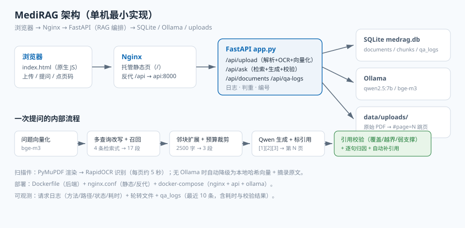
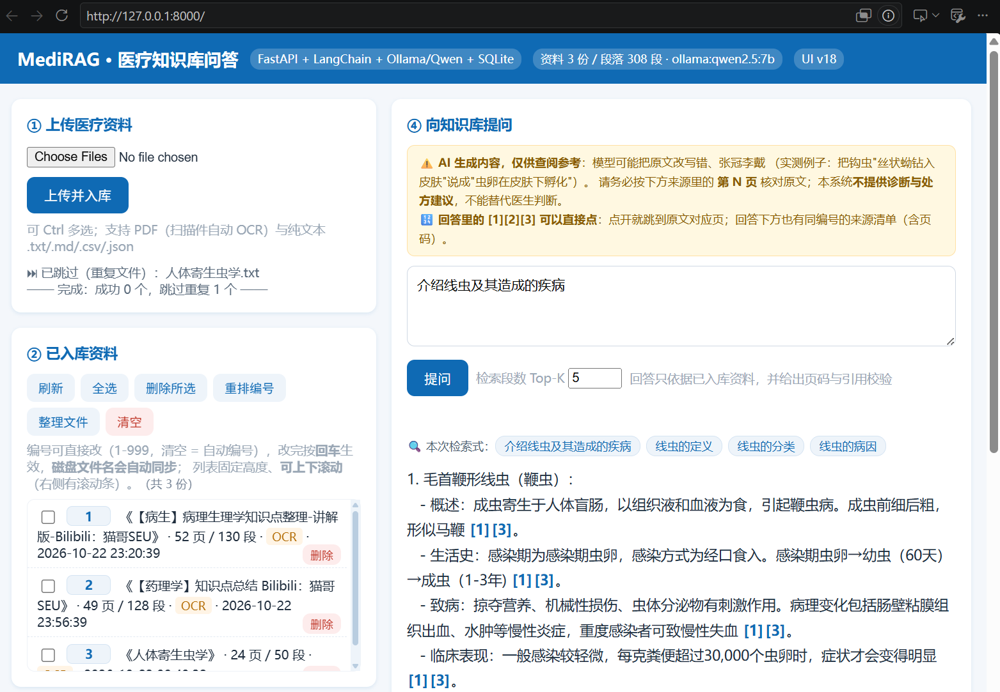
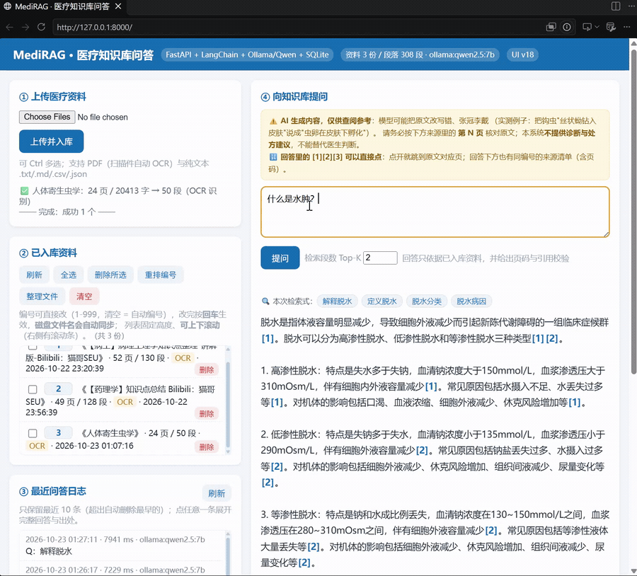

# MediRAG · 医疗知识库问答（RAG 最小可用实现）

上传医疗资料 → 切分 → 向量化 → 检索 → 本地大模型（Ollama/Qwen）生成**带页码出处**的回答，
并对每个回答自动做**引用校验**，标出"没标出处""和原文对不上"的句子。

后端单文件 `app.py`（约 1400 行）+ 前端单文件 `static/index.html`（约 540 行），覆盖：
Web 全栈 / REST API / SQLite / RAG / 工具调用 / Docker / Nginx / 日志 / 扫描件 OCR。

> ⚠️ 本项目是**技术演示**，不是医疗器械：回答仅供查阅参考，不提供诊断与处方建议。



**回答带页码出处，点 [1] 直接跳到原文第 5 页：**



更多运行截图与真实接口记录见 [`docs/demo.md`](docs/demo.md)。

## 目录结构

```
MediRAG/
├── app.py                  # 后端全部逻辑（FastAPI + LangChain + SQLite + OCR + 日志）
├── static/index.html       # 前端单页（原生 HTML/JS，无需构建）
├── requirements.txt        # Python 依赖
├── samples/                # 示例资料（2型糖尿病基层诊疗要点.txt）
├── tools/pdf_to_text.py    # 离线把 PDF（含扫描件）转 txt，适合几百页的教材
├── tools/video_to_gif.py   # 屏幕录制 → README 演示 GIF（两遍调色板法）
├── Dockerfile              # 后端镜像
├── nginx.conf              # Nginx：托管前端 + 反代 /api
├── docker-compose.yml      # 一键起 Nginx + FastAPI + Ollama
├── data/                   # 【运行时生成】medrag.db + uploads/（原始文件）
└── logs/                   # 【运行时生成】medrag.log（5MB × 5 份轮转）
```

## 快速开始

### 方式一：本地（Windows 示例）

```bash
python -m venv .venv && .venv\Scripts\activate
pip install -r requirements.txt

# 本地大模型（可选，不装会自动降级，见下）
ollama serve
ollama pull qwen2.5:7b     # 对话模型
ollama pull bge-m3         # 向量模型

uvicorn app:app --host 0.0.0.0 --port 8000 --reload
# 页面 http://localhost:8000   Swagger http://localhost:8000/docs
```

**没有 Ollama 也能跑**：启动日志会打印"降级为本地哈希向量 / 离线降级模式"，
入库和检索照常工作，回答退化为"返回最相关原文"。装好 Ollama 重启即自动切换真模型。

### 方式二：Docker

```bash
docker compose up -d --build
docker compose exec ollama ollama pull qwen2.5:7b
docker compose exec ollama ollama pull bge-m3
# 打开 http://localhost:8080
```

## 界面功能

| 区域 | 功能 |
| --- | --- |
| ① 上传 | 支持**多选批量上传**（串行处理）；扫描件自动 OCR；重复文件自动跳过 |
| ② 已入库资料 | 列表固定高度可滚动；**多选删除 / 全选 / 清空**；编号可直接编辑（回车生效）、一键重排、按编号整理磁盘文件名 |
| ③ 最近问答日志 | 只保留最近 10 条；点任意一条**展开完整历史回答**，里面的 `[1][2]` 同样可点开原文 |
| ④ 提问 | Top-K 可调；回答里的 `[1][2]` 可点击跳原文对应页；下方有引用条、核对指引、引用校验明细 |

## 接口清单

| 方法 | 路径 | 说明 |
| --- | --- | --- |
| GET | `/` | 前端页面（`Cache-Control: no-store`，改完刷新即生效） |
| GET | `/api/health` | 健康检查（Docker HEALTHCHECK 用） |
| POST | `/api/upload` | 上传资料（multipart，字段名 `file`）；重复内容返回 409 |
| POST | `/api/ask` | 提问：`{"question": "...", "top_k": 4}`，返回 `answer / sources / queries / grounding / disclaimer` |
| GET | `/api/documents` | 资料列表（含 `serial` 自定义编号与 `display_no` 显示编号） |
| PATCH | `/api/documents/{id}` | 改编号：`{"serial": 3}`，传 `null` 恢复自动 |
| POST | `/api/documents/renumber` | 按上传顺序把编号重排为 1..N |
| POST | `/api/documents/tidy` | 按编号重命名 `uploads/` 里的文件（不断开关联） |
| GET | `/api/documents/{id}/file` | 打开原始文件（PDF 可配 `#page=N` 跳到第 N 页；txt 按真实编码返回） |
| DELETE | `/api/documents/{id}` | 删除单份（连向量和原始文件一起删） |
| DELETE | `/api/documents` | 清空全部（问答日志保留） |
| GET | `/api/qa-logs?limit=10` | 最近问答日志（含完整回答/出处/校验结果） |

命令行自测：

```bash
curl -F "file=@samples/2型糖尿病基层诊疗要点.txt" http://localhost:8000/api/upload

curl -X POST http://localhost:8000/api/ask -H "Content-Type: application/json" \
  -d "{\"question\":\"2型糖尿病的一线用药是什么？\",\"top_k\":4}"

curl -X POST http://localhost:8000/api/ask -H "Content-Type: application/json" \
  -d "{\"question\":\"现在几点了？\"}"     # 验证工具调用
```

## 数据模型（SQLite 三张表）

| 表 | 关键字段 | 说明 |
| --- | --- | --- |
| `documents` | `id`（内部主键，不复用）、`serial`（自定义编号）、`page_count`、`source`(text-layer/ocr)、`stored_name`（磁盘文件名）、`hash`（sha256 判重） | 一份资料一行 |
| `chunks` | `doc_id`、`chunk_index`、`page`、`content`、`embedding`(JSON)、`dim` | 段落原文 + 向量，检索时按 `dim` 过滤 |
| `qa_logs` | `question`、`answer`、`sources`、`queries`、`grounding`、`latency_ms` | 只保留最近 10 条 |

## RAG 在这里是怎么跑的

1. **切分**：`RecursiveCharacterTextSplitter`，`chunk_size=500`、`overlap=80`，分隔符按中文习惯（段落→句号→分号→逗号）。
2. **向量化**：`OllamaEmbeddings(bge-m3)`，入库与查询必须同一模型；`chunks.dim` 记录了维度，换模型后旧向量不会串味。
3. **检索**：`search_chunks()` 用余弦相似度（单位向量点积）取 Top-K；相同内容按哈希去重。
4. **生成**：拼成 `[1] 出处《资料》第 N 页：…` 的【资料】区，配硬约束提示词（只依据资料、标编号、不编诊断）。

### Top-K 到底是什么（容易误解的地方）

`检索段数 Top-K` 是**候选上限**，不是最终喂给模型的段数。真实链路是：

```
多查询召回 17 段  →  取分数前 K=10 段  →  邻块扩展（每段最多 800 字）  →  按篇幅预算裁到 3 段  →  编号 [1][2][3]
```

最后一步 `fit_hits()` 受 `MAX_CONTEXT_CHARS=2500` 限制：3 段 × 800 字 ≈ 2400 字刚好装下，第 4 段超预算被丢弃。
所以**日志里"召回=3 段"是预算算出来的，不是检索只找到 3 段**；引用编号也永远从 [1] 开始、连续。
想让模型读更多段：调大 `MAX_CONTEXT_CHARS` 或把 `NEIGHBOR_WINDOW` 设为 0（每段约 500 字，2500 字能装 5 段）——
代价是上下文一长，7B 模型更容易丢"必须标引用"的格式要求。

## 抗幻觉设计（这是本项目最"医疗"的部分）

| 机制 | 说明 |
| --- | --- |
| 硬约束提示词 | 只依据资料作答；资料没有就说"资料中未提及"；编号只能用资料里存在的 |
| 引用校验 `check_grounding()` | 统计引用覆盖率、检测**越界编号**（编出 `[5]`）、找出**弱支撑句**（标了出处但和原文对不上） |
| 自动补引用 `CITATION_REPAIR` | 覆盖率 < 50% 时让模型对照同一份资料重写一次，只采纳"变好"的结果 |
| 逐句归因 `attribute_sentences()` | **不依赖模型自觉**：把每句和每段做字符 2-gram 比对，给出"最像第几页 / 相邻页 / 吻合度" |
| 页码溯源 | 每段记 `page`，回答里标"第 4 页"；PDF 可一键打开到该页 |
| 常驻免责 | 页面提示 + 每条回答的核对三步 + 接口 `disclaimer` 字段（第三方客户端口径一致） |

> 实测：qwen2.5:7b 对"必须标引用"的执行不稳定（同一问题有时 89%、有时 0%），
> 所以不能只靠提示词，必须有确定性的校验兜底。**校验通过 ≠ 内容正确**——
> 真实案例：模型把钩虫"丝状蚴钻入皮肤"写成"虫卵在皮肤下孵化"，引用标得完全正确，相似度校验挡不住。

## 支持的文件格式

| 格式 | 解析方式 | 页码含义 |
| --- | --- | --- |
| `.pdf` | PyMuPDF 抽文字层；扫描件/拍照版自动 OCR（RapidOCR） | **真实页码**，可跳转 |
| `.txt` / `.md` / `.csv` / `.json` | 直接解码（utf-8 → gb18030） | 整篇算第 1 页，按段号定位 |

Word / PPT / Excel / 图片暂不支持，请先另存为 PDF。
（曾用标准库 `zipfile` 解析过 docx/pptx/xlsx，为减少待测面已回退。）

### 判重与清理

- 上传时算文件内容 `sha256`，库里已有相同哈希 → **409**，不重复占用磁盘、不重跑 OCR；
- 改名后重传同样会被拦；内容改一个字则视为新文件；
- 删除资料会**同时删掉磁盘文件**（否则 `uploads/` 会越堆越大）；
- 老数据启动时自动补算哈希，历史资料同样参与判重。

## 资料编号与文件整理

- `id` 是 SQLite 自增主键，删掉的号不复用，所以会出现 6、7、8 这种跳号（界面上不显示）；
- 界面显示的是 `display_no`：优先用自定义 `serial`，没设就按顺序自动补号（跳过已占用的）；
- 点资料前面的编号可直接改（1-999，重复会提示占用），留空恢复自动，改完**磁盘文件名自动同步**；
- 「整理文件」= 批量把 `uploads/` 里的文件重命名成 `{编号}_{标题}.pdf`（路径记在库里，改名不断开关联）。

## 日志与运维

- 应用日志：控制台（`docker logs medrag-api`）+ `logs/medrag.log`（单文件 5MB × 5 份轮转）；
- Nginx 日志：含 `$request_time` 与 `$upstream_response_time`，可判断慢在网关还是应用；
- 每个请求都记录 `方法 路径 状态码 耗时`，响应头回传 `X-Process-Time-ms`；
- 每次问答落库 `qa_logs`（耗时、召回来源、检索式、校验结果），**只保留最近 10 条**（`QA_LOG_KEEP`）。

## 配置项（全部可用环境变量覆盖）

| 变量 | 默认 | 说明 |
| --- | --- | --- |
| `OLLAMA_BASE_URL` | `http://localhost:11434` | 容器内写 `http://ollama:11434` |
| `LLM_MODEL` / `EMBED_MODEL` | `qwen2.5:7b` / `bge-m3` | 对话模型 / 向量模型 |
| `TOP_K` | 4 | 检索候选段数 |
| `CHUNK_SIZE` / `CHUNK_OVERLAP` | 500 / 80 | 切分粒度 |
| `MAX_UPLOAD_MB` | 60 | 单文件上限（需与 nginx `client_max_body_size` 一致） |
| `OCR_ENABLED` / `OCR_DPI` / `OCR_MAX_PAGES` | true / 200 / 300 | 扫描件 OCR 开关、渲染 DPI、单次最多页数 |
| `MULTI_QUERY` / `MULTI_QUERY_N` | true / 3 | 多查询改写开关与条数 |
| `NEIGHBOR_WINDOW` / `NEIGHBOR_MAX_CHARS` | 1 / 800 | 邻块扩展窗口与单条最大字数 |
| `MAX_CONTEXT_CHARS` | 2500 | 送进 Prompt 的资料总字数上限 |
| `MIN_SUPPORT_RATIO` / `MIN_COVERAGE` / `CITATION_REPAIR` | 0.08 / 0.5 / true | 弱支撑阈值、补引用触发线、是否自动补引用 |
| `QA_LOG_KEEP` | 10 | 问答日志保留条数 |
| `DATA_DIR` / `LOG_DIR` / `DB_PATH` | `./data` / `./logs` / `data/medrag.db` | 数据与日志位置 |

## 常见问题

| 现象 | 原因 / 处理 |
| --- | --- |
| 启动提示"降级为本地哈希向量" | Ollama 没起或模型没 pull；检索效果一般属正常 |
| 上传 PDF 后"什么都搜不到" | 十有八九是扫描件无文字层；系统会自动 OCR，仍失败看接口 `detail` |
| 点引用报 "Failed to load PDF document" | 该来源是 txt 不是 PDF；新版已按真实类型返回并只给 PDF 生成跳页链接 |
| OCR 很慢 | CPU 每页 1~5 秒；`OCR_MAX_PAGES` 默认 300，大教材建议先用 `tools/pdf_to_text.py` 离线转 txt |
| 上传提示超过 60MB | 调 `MAX_UPLOAD_MB`，同时改 `nginx.conf` 的 `client_max_body_size` |
| 回答编造内容 | 看引用校验明细；调低 `MAX_CONTEXT_CHARS`、提高 `MIN_COVERAGE` |
| 设置的 Top-K 没生效 | 见上文"Top-K 到底是什么"：最终受 `MAX_CONTEXT_CHARS` 预算裁剪 |

## 演示材料

运行效果截图与真实接口记录见 [`docs/demo.md`](docs/demo.md)，图片在 `docs/images/`。

### 演示 GIF（可选，效果最好）

录一段 15~20 秒的操作（提问 → 点 `[1]` 跳到原文 → 展开引用校验），转成 GIF：

```bash
# 录制：Win + Alt + R（Windows 自带）、或 ScreenToGif（可直接导出 GIF）
# 转换：截取第 2~22 秒，900px 宽、10fps
python tools/video_to_gif.py demo.mp4 -o docs/images/demo.gif --start 2 --end 22 --fps 10 --width 900
```

脚本用**两遍调色板法**（`palettegen` → `paletteuse`）：颜色比直接 `-vf scale` 准、体积约小一半；
超过 8 MB 会自动降宽度重试。ffmpeg 二选一：`winget install Gyan.FFmpeg`，或 `pip install imageio-ffmpeg`。

然后在上面"演示材料"里加一行：

```markdown

```

## 技术栈

FastAPI · LangChain（core / text-splitters / ollama）· SQLite · PyMuPDF · RapidOCR · Ollama（Qwen2.5 / bge-m3）· Docker · Nginx · 原生 HTML/JS

## License

[MIT](LICENSE) © 2026 wblds666

> 本项目仅用于技术学习与演示，**不构成医疗器械或诊疗建议**；上传的资料请自行确认合规与脱敏。
