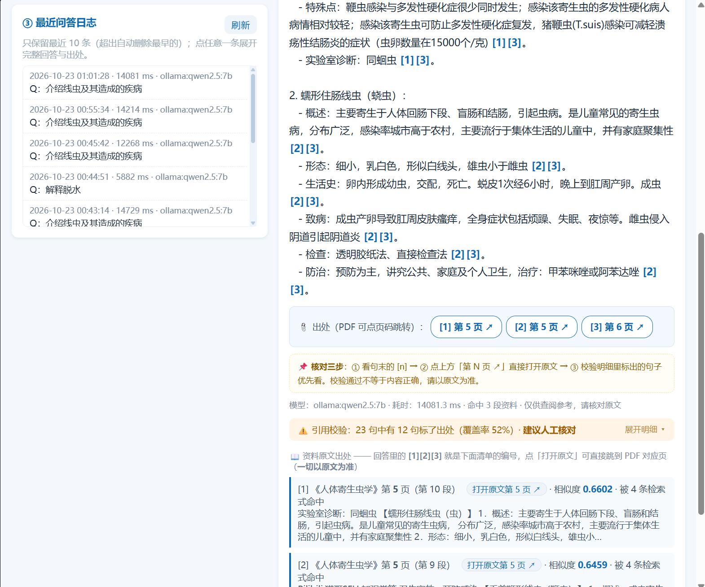
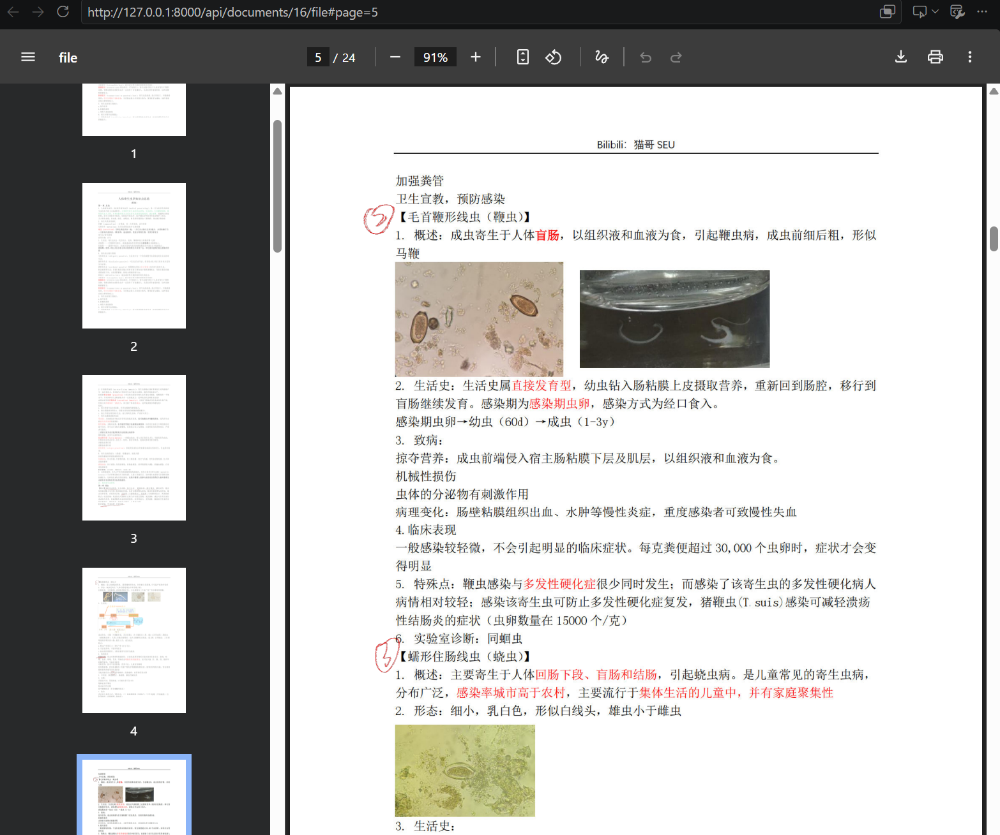
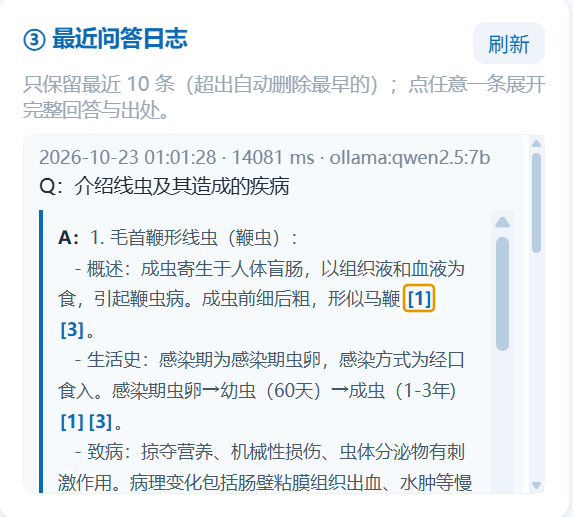
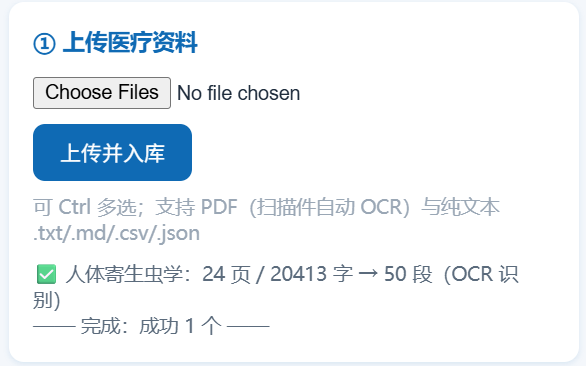
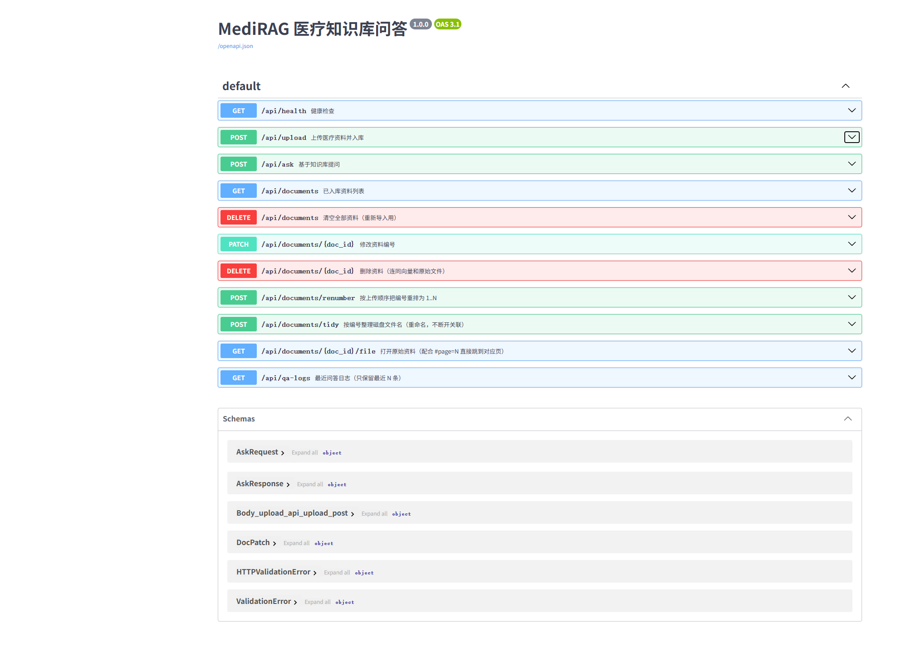
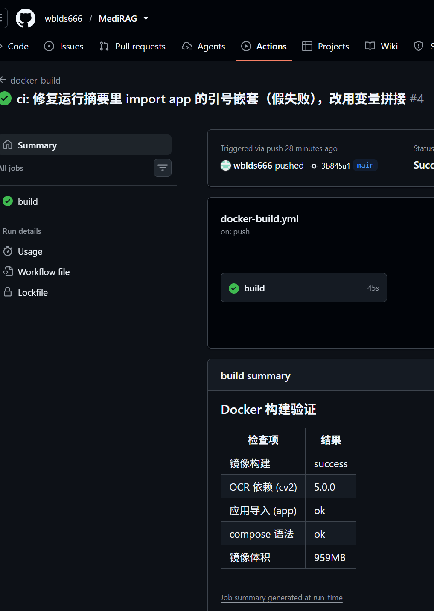

# 运行效果

真实运行截图与接口记录（Ollama + qwen2.5:7b + bge-m3，本机 CPU）。架构图见 [`architecture.svg`](architecture.svg)。

## 一、真实接口记录

以下为**实际运行**输出。

### 1) 健康检查

```bash
curl http://localhost:8000/api/health
```

```json
{"status":"ok","time":"2026-10-23 00:16:21","embed_model":"ollama:bge-m3","llm":"ollama:qwen2.5:7b","documents":3,"chunks":308}
```

### 2) 上传扫描件 PDF（自动 OCR）

```bash
curl -F "file=@人体寄生虫学.pdf" http://localhost:8000/api/upload
```

```json
{
  "doc_id": 12,
  "title": "人体寄生虫学",
  "pages": 24,
  "chars": 20413,
  "chunks": 50,
  "source": "ocr",
  "ocr": true,
  "text_quality": {"chars": 20413, "cjk_ratio": 0.756, "latin_ratio": 0.048},
  "embed_model": "ollama:bge-m3"
}
```

> 这份 PDF 是手机拍照导出的图片型 PDF：文字层只有 66 个乱码字符，自动切 OCR 后识别出 20413 字。

### 3) 提问（多查询检索 + 页码出处 + 引用校验）

```bash
curl -X POST http://localhost:8000/api/ask -H "Content-Type: application/json" \
  -d '{"question":"介绍线虫及其造成的疾病","top_k":10}'
```

关键字段（真实返回，节选）：

```json
{
  "queries": ["介绍线虫及其造成的疾病", "线虫的定义", "线虫的分类", "线虫的病因"],
  "sources": [
    {"index": 1, "title": "人体寄生虫学", "file_type": ".pdf", "page": 5, "chunk_index": 10, "score": 0.6602},
    {"index": 2, "title": "人体寄生虫学", "file_type": ".pdf", "page": 5, "chunk_index": 9,  "score": 0.6459},
    {"index": 3, "title": "人体寄生虫学", "file_type": ".pdf", "page": 6, "chunk_index": 11, "score": 0.634}
  ],
  "grounding": {"sentences": 23, "cited": 12, "coverage": 0.522, "verdict": "建议人工核对"},
  "model": "ollama:qwen2.5:7b",
  "latency_ms": 14213.6
}
```

**留意 Top-K=10 但只返回 3 条来源**：候选取前 10 段后，还要过 `MAX_CONTEXT_CHARS=2500` 的字数预算，
每段邻块扩展后最多 800 字，2500 字只装得下 3 段 —— 日志里会打印 `召回=3段`。

### 4) 重复上传被拒

```bash
curl -F "file=@人体寄生虫学.pdf" http://localhost:8000/api/upload   # 再传一次
```

```json
{"detail": "该文件已入库（资料 #10《人体寄生虫学》），无需重复上传；如需重新解析请先删除旧资料。"}
```

HTTP 状态码 **409**；改名后重传同样会被拦（按内容 sha256 判重）。

### 5) 工具调用（问时间）

```bash
curl -X POST http://localhost:8000/api/ask -H "Content-Type: application/json" \
  -d '{"question":"现在几点了？"}'
```

```json
{"answer": "当前时间 2026-10-23 00:12:31 Friday", 
 "tool_calls": [{"name": "get_current_time", "args": {"timezone": "Asia/Shanghai"}, "mode": "model-driven"}]}
```

## 二、界面截图

### 0. 演示 GIF（17 秒全流程）


提问"什么是水肿" → 回答带出处编号 → 点 `[1]` 跳到 PDF 第 7 页 → 引用校验 100% ok。
由 `tools/video_to_gif.py` 从 17 秒录屏转换（900px / 10fps / 5.5MB / 174 帧）。

### 1. 主问答界面（回答 + 引用编号）


问题"介绍线虫及其造成的疾病"的回答，句末 `[1][3]` 是资料编号；左侧资料列表显示编号、页数、段数、OCR 标记。

### 2. 出处、核对指引与引用校验（下半屏）



- `📎 出处（PDF 可点页码跳转）：[1] 第 5 页 ↗ [2] 第 5 页 ↗ [3] 第 6 页 ↗`
- 核对三步提示 + 常驻免责
- `引用校验：23 句中有 12 句标了出处（覆盖率 52%）· 建议人工核对`
- 来源清单：每段显示「第 N 页（第 M 段）· 相似度 · 被几条检索式命中」

### 3. 点 [1] 直接跳到原文第 5 页（页码溯源是真的）



点击 `[1]` 后地址栏是 `/api/documents/16/file#page=5`，浏览器内置阅读器停在 **5 / 24 页**，
正文正是该段引用的"毛首鞭形线虫（鞭虫）"—— 说明"第 N 页"不是模型编的，是入库时记下来的。

### 4. 最近问答日志（展开查看历史回答）



只保留最近 10 条；点任意一条展开完整回答，历史回答里的 `[1]` 同样可以点开原文。

### 5. 扫描件 OCR 入库



手机拍照导出的图片型 PDF：文字层只有 66 个乱码字符，自动切 OCR 后 `24 页 / 20413 字 → 50 段`。

### 6. 资料管理（编号 / 多选 / 滚动）


编号就地编辑（回车生效，磁盘文件名自动同步）、勾选多选删除、重排编号、整理文件、清空；
列表固定高度、右侧有滚动条。

### 7. 引用校验明细（展开「明细」后）


点"展开明细"会列出：未标出处的句子、与引用原文对不太上的句子、以及**逐句定位**
（每句最像第几页 + 相邻页 + 吻合度）—— 模型不标引用时，这一列就是人工复核清单。

### 8. 接口文档（Swagger UI）



FastAPI 根据代码**自动生成**的交互式文档，`http://127.0.0.1:8000/docs` 打开即是：
12 个接口、按 HTTP 方法着色（GET 蓝 / POST 绿 / PATCH 青 / DELETE 红），
点任一接口可展开参数并 **Try it out** 直接发请求，底部 `Schemas` 是 `AskRequest` / `AskResponse` / `DocPatch` 等 Pydantic 模型的字段定义。

### 9. CI 构建验证（GitHub Actions）



每次 push，GitHub Actions 会在 `ubuntu-latest` 上真机构建镜像并跑 4 项检查：

| 检查项 | 结果 | 说明 |
| --- | --- | --- |
| 镜像构建 | success | `docker build` 在 Linux 上通过（apt 装 libGL、pip 装依赖） |
| OCR 依赖 (cv2) | 5.0.0 | 容器内 `import cv2` 正常 → 扫描件 OCR 可用 |
| 应用导入 (app) | ok | FastAPI / LangChain / Pydantic 依赖齐全 |
| compose 语法 | ok | `docker compose config` 校验通过 |
| 镜像体积 | 959 MB | onnxruntime + opencv + numpy + PyMuPDF |

工作流文件：[`.github/workflows/docker-build.yml`](../.github/workflows/docker-build.yml)
